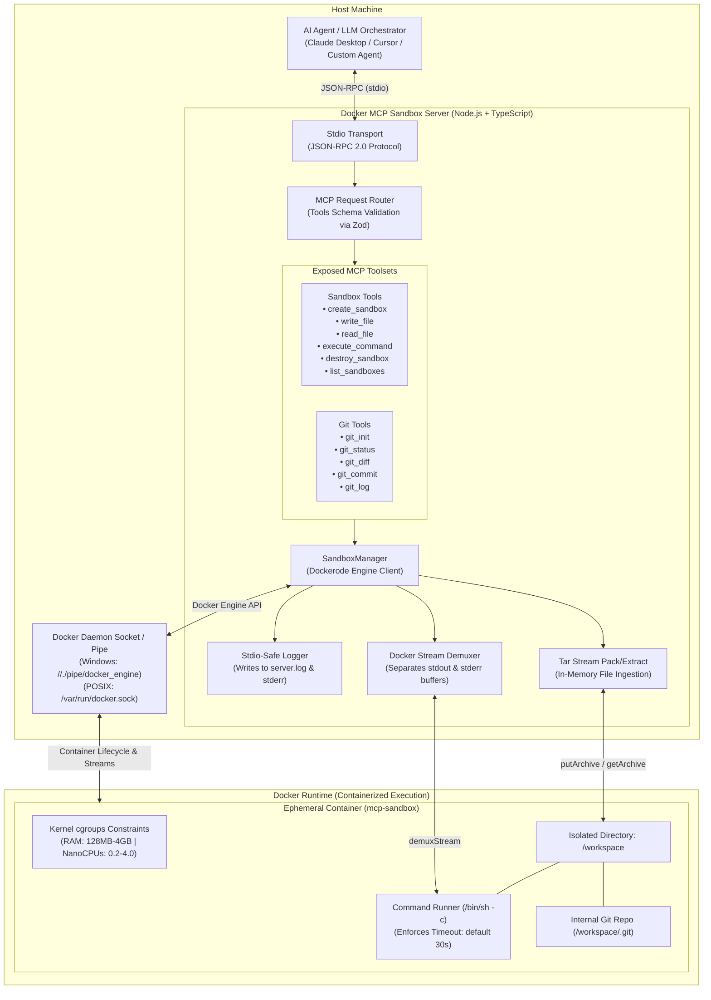

# 🐳 Docker MCP Sandbox

[](https://www.typescriptlang.org/)
[](https://nodejs.org/)
[](https://www.docker.com/)
[](https://modelcontextprotocol.io/)
[](LICENSE)

An enterprise-ready **Model Context Protocol (MCP)** server providing secure, disposable, and resource-bounded Docker container sandboxes for AI agents. Designed for autonomous LLM systems (such as Claude Desktop, Cursor IDE, and custom agent orchestration engines), this server allows agents to create files, inspect code, run shell commands with execution timeouts, and perform Git operations without endangering the host environment.

---

## 📑 Table of Contents

- [Overview](#-overview)
- [System Architecture](#-system-architecture)
- [Core Engineering Highlights](#-core-engineering-highlights)
- [Technical Stack](#-technical-stack)
- [Available MCP Tools](#-available-mcp-tools)
- [Docker Sandbox Execution Workflow](#-docker-sandbox-execution-workflow)
- [Security Model & Resource Controls](#-security-model--resource-controls)
- [Getting Started](#-getting-started)
  - [Prerequisites](#prerequisites)
  - [Installation & Compilation](#installation--compilation)
  - [Automated Verification Harness](#automated-verification-harness)
- [Client Integration Configurations](#-client-integration-configurations)
  - [Claude Desktop](#claude-desktop)
  - [Cursor IDE](#cursor-ide)
- [Project Layout](#-project-layout)
- [Roadmap & Future Enhancements](#-roadmap--future-enhancements)
- [License](#-license)

---

## 🔍 Overview

Autonomous AI coding agents frequently require terminal access, filesystem manipulation, and dependency installation. Allowing untrusted agentic actions directly on a developer workstation or production host introduces severe risks:

- Accidental deletion or overwrite of host files and system paths.
- Unconstrained execution loops consuming memory and CPU.
- Host environment contamination through rogue background processes.
- Accidental disclosure of local environment variables and developer credentials.

**Docker MCP Sandbox** solves this by establishing a secure boundary between the agent and host. Every workspace is provisioned inside an ephemeral Docker container bounded by strict CPU and memory limits. Files are ingested and extracted via memory-buffered tar streams, and shell commands are demuxed in real-time with configurable millisecond timeout limits.

---

## 🏗️ System Architecture

The following diagram illustrates the complete execution pipeline from AI prompt to containerized isolation:



---

## ⚡ Core Engineering Highlights

### 1. Pure Stdio Protocol Safety
MCP servers rely strictly on `process.stdout` for JSON-RPC frame serialization. Unchecked `console.log()` statements from libraries or diagnostics will instantly corrupt framing, severing connection to the client. Docker MCP Sandbox incorporates a dedicated Stdio-safe logger that directs all operational diagnostics to `server.log` (resolved relative to the project root) and mirrors warnings to `process.stderr`, guaranteeing absolute protocol integrity.

### 2. Native Cross-Platform Socket Resolution
Seamlessly interoperates with Docker on all operating systems without manual socket mapping:
- **Windows**: Automatically binds to the named pipe `//./pipe/docker_engine`.
- **macOS / Linux**: Automatically connects to `/var/run/docker.sock`.
- **Remote / Custom**: Respects explicit `DOCKER_HOST` environment configurations.

### 3. Path Traversal & Escape Prevention
Every file access operation (`read_file`, `write_file`, and working directory selection) undergoes strict path sanitization. Relative path normalizations reject path traversal sequences (`..`), leading slashes, null byte injections (`\0`), and Windows drive letter patterns (`C:`), enforcing containment within `/workspace`.

### 4. Tar-Stream Memory Multiplexing
File uploads and downloads do not mount host directories or generate temporary files on the host disk. Instead, files are packaged as in-memory POSIX tar streams using `tar-stream` and streamed directly via the Docker Engine API `putArchive` and `getArchive` endpoints.

### 5. Stream Demuxing & Command Timeout Enforcement
Commands executed inside containers run under an active watch timer. If a command runs past its allocated duration (default 30 seconds), execution aborts with standard POSIX timeout exit code `124`. Output streams are demultiplexed via `docker.modem.demuxStream`, reliably separating `stdout` from `stderr`.

### 6. Orphan Container Sweeping & Graceful Teardown
Each container is provisioned with custom metadata labels (`mcp-sandbox=true` and `mcp-sandbox-id`). The server registers lifecycle hooks for `SIGINT`, `SIGTERM`, `uncaughtException`, and `unhandledRejection`, automatically inspecting the daemon and destroying active or orphaned sandboxes upon exit.

---

## 🛠️ Technical Stack

| Category | Technology | Purpose |
|---|---|---|
| **Runtime** | Node.js (v20+ LTS) | Primary server runtime utilizing modern ES Modules (`NodeNext`) |
| **Language** | TypeScript (v5.8+) | End-to-end type safety, declaration generation, and static validation |
| **Protocol** | `@modelcontextprotocol/sdk` (v1.6+) | Official MCP implementation for server-client JSON-RPC communication |
| **Containerization** | `dockerode` (v4.0+) | Programmatic Docker Engine API client for container orchestration |
| **Archival Streaming** | `tar-stream` (v3.1+) | In-memory streamable tar packing/extracting for file I/O |
| **Schema Validation** | `zod` (v3.24+) | Runtime schema enforcement for all incoming tool parameters |
| **Testing Harness** | `tsx` + automated client script | Full end-to-end integration and security test suite |

---

## 🧰 Available MCP Tools

The server exposes 11 specialized tools split across core sandbox execution and version control:

### Sandbox Management & Execution

| Tool | Parameters | Default | Description |
|---|---|---|---|
| `create_sandbox` | `image` (string)<br/>`memoryLimitMb` (number)<br/>`cpuLimit` (number)<br/>`env` (object) | `node:20-alpine`<br/>`512`<br/>`1.0`<br/>`{}` | Provisions an isolated Docker container with a `/workspace` directory, cgroups limits, and returns a unique `sandboxId`. |
| `write_file` | `sandboxId` (string, UUID)<br/>`path` (string)<br/>`content` (string) | _(required)_<br/>_(required)_<br/>_(required)_ | Writes text or code to `/workspace/<path>` inside the sandbox with path traversal verification. |
| `read_file` | `sandboxId` (string, UUID)<br/>`path` (string) | _(required)_<br/>_(required)_ | Reads file contents and byte length from `/workspace/<path>`. |
| `execute_command` | `sandboxId` (string, UUID)<br/>`command` (string)<br/>`timeoutMs` (number)<br/>`workingDir` (string) | _(required)_<br/>_(required)_<br/>`30000`<br/>`/workspace` | Executes a shell command inside the container; returns `stdout`, `stderr`, `exitCode`, `executionTimeMs`, and `timedOut`. |
| `destroy_sandbox` | `sandboxId` (string, UUID) | _(required)_ | Immediately terminates and removes the container, reclaiming host resources. |
| `list_sandboxes` | _none_ | _none_ | Returns a listing of all currently running sandbox containers and their metadata. |

### Git Workflow Automation

| Tool | Parameters | Default | Description |
|---|---|---|---|
| `git_init` | `sandboxId` (string, UUID)<br/>`initialBranch` (string)<br/>`userName` (string)<br/>`userEmail` (string) | _(required)_<br/>`main`<br/>`AI Agent`<br/>`agent@mcp.local` | Initializes a Git repository in `/workspace`, sets safe directory flags, and configures committer identity. Auto-installs `git` if missing. |
| `git_status` | `sandboxId` (string, UUID) | _(required)_ | Inspects working directory state and uncommitted/untracked files. |
| `git_diff` | `sandboxId` (string, UUID)<br/>`cached` (boolean)<br/>`file` (string) | _(required)_<br/>`false`<br/>_optional_ | Returns unified diffs for unstaged changes, or staged changes if `cached: true`. |
| `git_commit` | `sandboxId` (string, UUID)<br/>`message` (string)<br/>`addFiles` (string[])<br/>`authorName` (string)<br/>`authorEmail` (string) | _(required)_<br/>_(required)_<br/>`["."]`<br/>_optional_<br/>_optional_ | Stages specified files and commits with the provided message and author attributes. |
| `git_log` | `sandboxId` (string, UUID)<br/>`maxCount` (number) | _(required)_<br/>`10` | Retrieves recent commit history formatted as structured JSON objects (`hash`, `author`, `date`, `message`). |

---

## 🔄 Docker Sandbox Execution Workflow

Here is a typical interaction pattern executed by an AI agent:

```
[Agent] ──> create_sandbox({ image: "node:20-alpine", memoryLimitMb: 512 })
           └── Returns: { sandboxId: "8dfa723f-ed58-434d-9960-8c755964cf1a" }

[Agent] ──> write_file({ sandboxId, path: "calc.js", content: "console.log(10 * 5);" })
           └── Returns: { success: true, bytesWritten: 25, path: "calc.js" }

[Agent] ──> execute_command({ sandboxId, command: "node calc.js" })
           └── Returns: { stdout: "50\n", stderr: "", exitCode: 0, executionTimeMs: 120 }

[Agent] ──> git_init({ sandboxId })
           └── Returns: { initialized: true, stdout: "Initialized empty Git repository..." }

[Agent] ──> git_commit({ sandboxId, message: "feat: add initial math script" })
           └── Returns: { success: true, output: "[main (root-commit)] feat: add initial..." }

[Agent] ──> destroy_sandbox({ sandboxId })
           └── Returns: { success: true, message: "Sandbox successfully destroyed." }
```

---

## 🛡️ Security Model & Resource Controls

### What This Sandbox Guarantees
- **Host Filesystem Isolation**: Container processes run inside isolated container layers. The host filesystem is never mounted into the container.
- **Resource Quotas**: Hard RAM thresholds (`Memory`) prevent Out-Of-Memory (OOM) lockups on the host machine. NanoCPUs throttles compute consumption.
- **Execution Containment**: Infinite loops or hung commands are halted automatically when `timeoutMs` expires.
- **Path Confinement**: Path traversal checks reject attempts to manipulate paths outside `/workspace`.

### Honest Security Disclosures & Production Considerations
- **Shared Kernel Architecture**: Docker containers share the host Linux kernel (or WSL2 VM on Windows). Containerization provides practical process isolation, but is not an impenetrable security sandbox against sophisticated kernel-level privilege escalation or zero-day kernel exploits.
- **Network Access**: Containers currently default to Docker `bridge` networking, permitting outgoing HTTP/HTTPS calls (useful for `npm install`, `pip install`, or `apk add`). For ultra-high-security environments requiring air-gapped sandboxes, NetworkMode can be configured to `none`.
- **Root inside Container**: The container runtime runs under default image users (often root within the container namespace). While confined from host root privileges, running untrusted compiled binary executables should be evaluated carefully in multi-tenant environments.

---

## 🚀 Getting Started

### Prerequisites
- **Node.js**: `v20.0.0` or higher
- **npm**: `v10.0.0` or higher
- **Docker**: Docker Desktop (Windows/macOS) or Docker Engine (Linux) running locally

### Installation & Compilation

```bash
# 1. Clone the repository
git clone https://github.com/thedailyhub31-blip/docker-mcp-sandbox.git
cd docker-mcp-sandbox

# 2. Install dependencies
npm install

# 3. Compile TypeScript code
npm run build
```

The compiled JavaScript output and type declarations will be placed into the `dist/` directory.

### Automated Verification Harness

A full end-to-end verification script is included to validate the entire workflow (container lifecycle, file I/O, path traversal defenses, timeouts, and Git tools):

```bash
npm run test:client
```

Sample successful verification output:
```
======================================================
   MCP DEV SANDBOX - AUTOMATED VERIFICATION SUITE
======================================================

✔ Connected to MCP Server over Stdio transport.
✔ Found 11 available tools.
✔ create_sandbox: container running with node:20-alpine
✔ write_file: wrote 240 bytes to /workspace/src/app.js
✔ read_file: successfully verified content integrity
✔ execute_command: exitCode: 0, executionTime: 1012ms
✔ Command timeout: sleep 10 correctly aborted after 2000ms (exit code 124)
✔ Path traversal defense: blocked malicious relative traversal
✔ Git tools: initialized, tracked, committed, and extracted log history
✔ destroy_sandbox: container cleanly removed
======================================================
   ALL MCP DEV SANDBOX VERIFICATIONS PASSED SUCCESSFULLY!
======================================================
```

---

## ⚙️ Client Integration Configurations

### Claude Desktop

To connect Docker MCP Sandbox to Claude Desktop:

1. Open your Claude configuration file:
   - **Windows**: `%APPDATA%\Claude\claude_desktop_config.json`
   - **macOS**: `~/Library/Application Support/Claude/claude_desktop_config.json`

2. Add `docker-mcp-sandbox` to the `mcpServers` object:

```json
{
  "mcpServers": {
    "docker-mcp-sandbox": {
      "command": "node",
      "args": [
        "<PATH_TO_PROJECT>/dist/index.js"
      ]
    }
  }
}
```

*(Replace `<PATH_TO_PROJECT>` with your absolute local repository path, e.g. `C:/Users/username/Desktop/docker-mcp-sandbox`)*

### Cursor IDE

To use Docker MCP Sandbox in Cursor:

1. Create or open `.cursor/mcp.json` inside your project or home directory:

```json
{
  "mcpServers": {
    "docker-mcp-sandbox": {
      "command": "node",
      "args": [
        "${workspaceFolder}/dist/index.js"
      ]
    }
  }
}
```

2. Restart Cursor or reload MCP servers to enable the sandbox tools in agent mode.

---

## 📁 Project Layout

```
docker-mcp-sandbox/
├── src/
│   ├── index.ts                 # MCP Server bootstrap, Stdio transport, shutdown lifecycle
│   ├── docker/
│   │   └── sandboxManager.ts    # Dockerode client, container management, tar streaming, timeouts
│   ├── tools/
│   │   ├── sandboxTools.ts      # Core sandbox MCP tools (create, write, read, exec, destroy, list)
│   │   └── gitTools.ts          # Git workflow MCP tools (init, status, diff, commit, log)
│   └── utils/
│       └── logger.ts            # Stdio-safe logger writing to server.log and mirroring to stderr
├── scripts/
│   └── test-client.ts           # Automated end-to-end integration test harness
├── dist/                        # Compiled production code (generated by build)
├── package.json                 # Project dependencies, scripts, and package metadata
├── tsconfig.json                # TypeScript compiler configuration (NodeNext, ES2022)
├── .gitignore                   # Exclusions for build artifacts, node_modules, and secrets
├── LICENSE                      # MIT Open-Source License
└── README.md                    # Engineering documentation and architectural guide
```

---

## 🗺️ Roadmap & Future Enhancements

- [ ] **Configurable Network Policies**: Toggle network isolation mode (`bridge` vs `none`) dynamically per sandbox.
- [ ] **Pre-Warmed Container Pools**: Maintain warm container standby pools to reduce startup latency under heavy multi-agent workloads.
- [ ] **Custom Volume Cache Mounts**: Allow controlled read-only package caching (e.g. shared `npm-cache` or `pip-cache`) across ephemeral runs.
- [ ] **WebAssembly / MicroVM Backend**: Support pluggable hypervisor backends (Firecracker or gVisor) for enhanced multi-tenant security isolation.

---

## 📄 License

Distributed under the [MIT License](LICENSE). Free for commercial and private open-source use.
